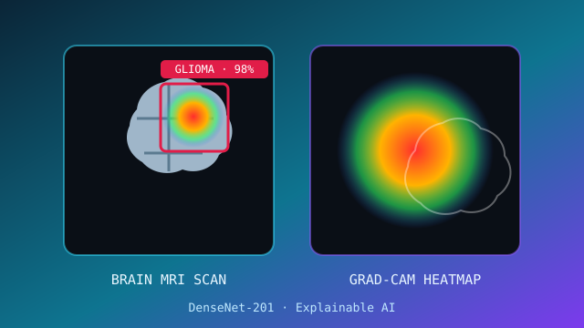
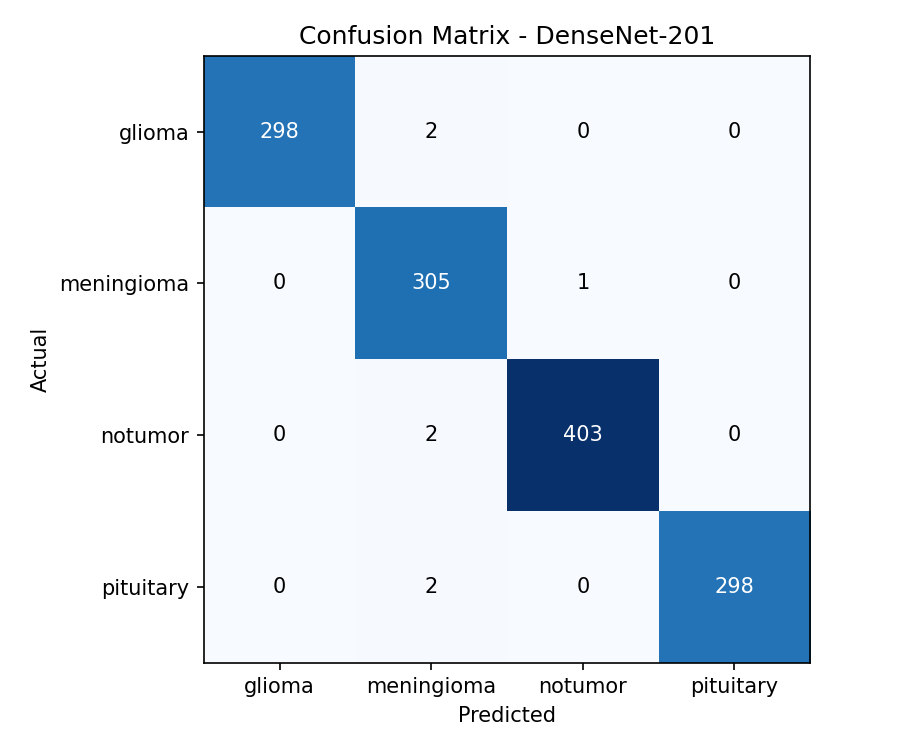
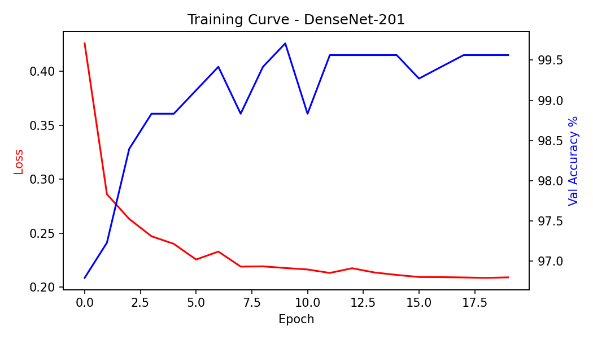
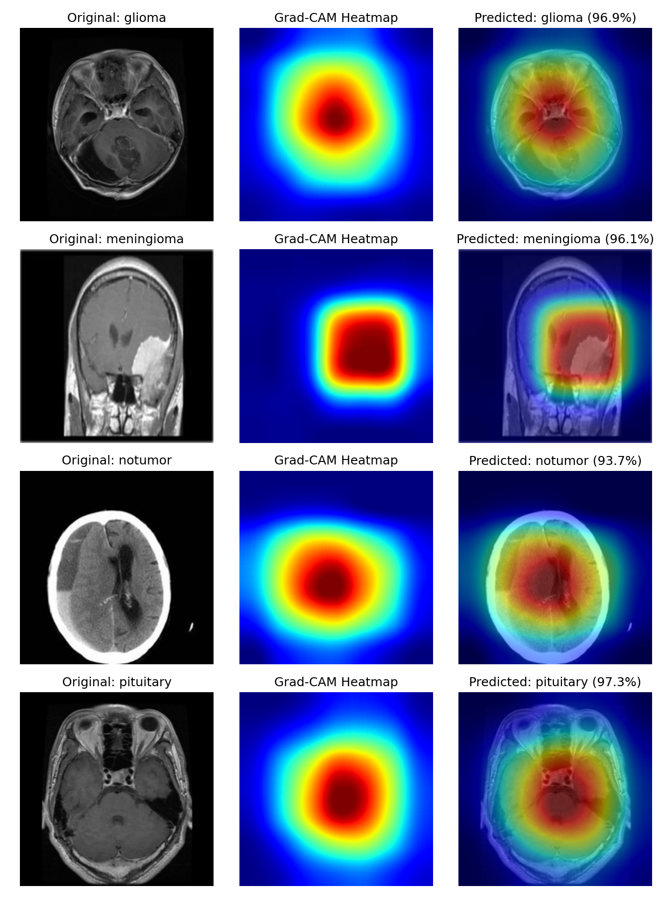

<div align="center">





<br/>


<br/>

<a href="model/BrainTumor.ipynb"></a>
<a href="https://drive.google.com/file/d/171SvOajLgFVQg6THsoBHnzSJofJpGlFp/view?usp=sharing"></a>
<a href="paper/"></a>
<a href="https://fcub-cse-brain-tumor-mri-ai.static.hf.space"></a>
<a href="https://github.com/Sadhin404/Ai-ML-Deep-Learning-Project/releases/tag/brain-tumor-v1.0"></a>

**A deep-learning project — an AI second reader for brain MRI, with an explanation for every decision.**

</div>

---

## ✦ What is this project?

A brain tumour found early is far more treatable than one found late — but reading MRI scans is slow, expert work. This project builds an **explainable AI system** that reads a brain MRI image and classifies it into one of four classes:

| Class | Meaning |
|---|---|
| 🔴 **Glioma** | A tumour growing from glial cells inside the brain tissue itself — the most complex type |
| 🟠 **Meningioma** | A tumour arising from the meninges, the membranes covering the brain — usually slow-growing and benign |
| 🟣 **Pituitary** | A growth in the pituitary gland beneath the brain — can affect hormones and vision |
| 🟢 **No Tumor** | No tumour — a healthy scan |

The system does not just give an answer — with **Grad-CAM** it paints a heatmap over the scan showing **which region drove the decision**, so a doctor can verify the model actually looked at the tumour. It is a **decision-support tool**: a fast, tireless second reader that supports clinicians — never replaces them, and never replaces biopsy, the gold standard.

## 🌐 Live Website — try it now

The trained model is deployed as a web app: upload a brain MRI scan and get the prediction with class probabilities, a Grad-CAM heatmap, a **focus box** marking the region that drove the decision, and a downloadable **PDF report**. The site also checks that the uploaded image really looks like an MRI scan before analysing it.

**▶ Live demo: [fcub-cse-brain-tumor-mri-ai.static.hf.space](https://fcub-cse-brain-tumor-mri-ai.static.hf.space)** — Hugging Face Spaces (static hosting; the model runs 100% in your browser, no server to wake up)

**▶ Short link: [tinyurl.com/BrainTumorMRI](https://tinyurl.com/BrainTumorMRI)** — the same live site, short enough to type or say out loud

All the website code and details live in the **[Website/](Website/)** folder:

- `Website/static-app/` — the version running live on Hugging Face (in-browser ONNX model)

## 🏆 Results — official run (Google Colab, Tesla T4)

| Metric | Score |
|---|---|
| **Test Accuracy** | **99.47%** (1304 / 1311) |
| **Macro F1** | **99.46%** |

| Class | Precision | Recall | F1 | Support |
|---|---|---|---|---|
| Glioma | **100.00%** | 99.33% | 99.67% | 300 |
| Meningioma | 98.07% | 99.67% | 98.87% | 306 |
| No Tumor | 99.75% | 99.51% | 99.63% | 405 |
| Pituitary | **100.00%** | 99.33% | 99.67% | 300 |

Only **7 of 1,311** test images were misclassified. Six of the seven errors were read as *meningioma* (2 glioma, 2 healthy and 2 pituitary scans), and one meningioma was read as *No Tumor* — the full analysis is in [`results/results.txt`](results/results.txt).

<div align="center">


</div>

## 🔬 Explainability — Grad-CAM

<div align="center">

</div>

For correct predictions the heatmaps sit on the tumour itself — the same place a radiologist would look. A heatmap is a sensitivity map, not clinical proof — the paper states this limitation openly.

## 🧠 How it works

```
Brain MRI image (Nickparvar dataset)
      │
      ▼
Preprocessing — resize 224×224 · normalise · (training only: augmentation)
      │
      ▼
DenseNet-201 — ImageNet-pretrained, fine-tuned end to end
      │
      ▼
4-class prediction + confidence
      │
      ▼
Grad-CAM heatmap — the explanation
```

**Key design choices**

- **Transfer learning** — the ImageNet-pretrained backbone already understands edges, shapes and textures; only the classifier head (dropout 0.3 + linear) is new, and the whole network is fine-tuned.
- **DenseNet-201, chosen by experiment** — ResNet-34, EfficientNet-B0 and DenseNet-201 were compared first; DenseNet-201 scored highest, and it also holds the highest published accuracy on this dataset (99.77%, ELCVIA). Dense feature reuse suits the subtle texture differences between tumour types.
- **Best-checkpoint selection** — after every epoch the model is scored on the validation split (macro F1); only the best checkpoint is kept, and the test set is evaluated **exactly once**, at the very end.
- **Label smoothing (0.05)** and **augmentation** (random resized crop, horizontal flip, ±15° rotation, brightness/contrast jitter) against overconfidence and overfitting.
- **AdamW + cosine schedule** — lr 1e-4, weight decay 1e-4, batch 32, 20 epochs.
- **Honest evaluation** — the split is regenerated from seed 42, so re-running the notebook reproduces the exact same train/validation split; small run-to-run variation of an image or two is normal for GPU training.

## 📦 The dataset — Brain Tumor MRI (Nickparvar)

**7,023 real MRI images** in four classes (Masoud Nickparvar, Kaggle):

| Split | Glioma | Meningioma | No Tumor | Pituitary | Total |
|---|---|---|---|---|---|
| Training | 1,321 | 1,339 | 1,595 | 1,457 | 5,712 |
| Testing | 300 | 306 | 405 | 300 | 1,311 |

The Training folder is split further (seed 42, stratified) into **5,026 train + 686 validation** images; the Testing folder is the held-out test set.

> ⚠️ **Version warning:** Kaggle's dataset page now serves a *rebalanced* 7,200-image version (1,400/class in Training, 400/class in Testing). This project — and every published result it compares with — uses the **original 7,023-image version**, which survives at the version link in [dataset/DATASET.md](dataset/DATASET.md).

📥 **Get it:** [Download `archive.zip` from Google Drive](https://drive.google.com/file/d/171SvOajLgFVQg6THsoBHnzSJofJpGlFp/view?usp=sharing) · details in [dataset/DATASET.md](dataset/DATASET.md)

## 🛠 Tech stack

| Choice | Why this one |
|---|---|
| **Python + PyTorch** | The research standard; full control over gradients — needed for a hand-built Grad-CAM |
| **DenseNet-201** | Best performer in the model comparison; dense connections reuse features efficiently |
| **Google Colab · Tesla T4** | Free GPU — the full training takes minutes instead of hours on CPU |
| **Grad-CAM** | Fast, CNN-native explanations (LIME/SHAP are far slower on images) |
| **ONNX Runtime Web** | The same trained model runs inside the visitor's browser on the live website — verified to give identical predictions to PyTorch |

## 📂 What's inside

```
Brain tumor/
├── assets/              ← the project code as .py files, the run guide & README artwork
│   ├── dataset.py  model.py  train.py
│   ├── evaluate.py predict.py gradcam.py
│   ├── requirements.txt
│   ├── HOW_TO_RUN.md    ← step-by-step, error-proof run guide
│   └── art.svg
├── model/               ← the training notebook
│   └── BrainTumor.ipynb   ← the full pipeline — run this in Colab
├── paper/               ← the full project paper (PDF)
├── slide/               ← the presentation (PPTX)
├── results/             ← metrics + figures from the official run
├── dataset/             ← about the Brain Tumor MRI dataset
└── Website/             ← the live web app
```

The trained checkpoint (`best_model.pth`, 73.7 MB) is attached to the [**brain-tumor-v1.0 release**](https://github.com/Sadhin404/Ai-ML-Deep-Learning-Project/releases/tag/brain-tumor-v1.0) — it is too large to keep in the git tree.

## ⚠️ Limitations — stated honestly

- Single public dataset — external validation on other hospitals' data is future work.
- This benchmark is known to contain near-duplicate scans, so scores on it (ours and the published 99%+ results alike) are **benchmark performance, not clinical performance**.
- The split is image-level (the dataset provides no patient IDs), so patient-independent generalisation is **not** claimed.
- Grad-CAM shows where the model is sensitive — it is an aid to verification, not medical evidence.

## 👨‍💻 Author

<div align="center">


**MD. Shadhin Khan**
<br/>Student ID: 0572310005101003
<br/>Department of Computer Science & Engineering
<br/>First Capital University of Bangladesh, Chuadanga
<br/>**Supervisor:** Md. Rashed Billah, Lecturer, CSE
<br/>**Co-Supervisor:** Nurunnahar Tisha, Lecturer, CSE

<br/><a href="https://www.facebook.com/share/1GRMfN9pwh"></a>&nbsp;<a href="https://www.instagram.com/sadhin.404"></a>&nbsp;<a href="https://github.com/Sadhin404"></a>

</div>

---

<div align="center">

*Built to be understood — every number in this README comes from the saved outputs of the official run, and every step can be reproduced from the notebook.*

© 2026 Shadhin Khan • Explainable Brain Tumor Classification Using DenseNet-201 and Grad-CAM


</div>
