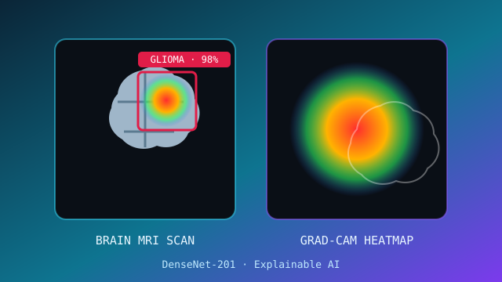
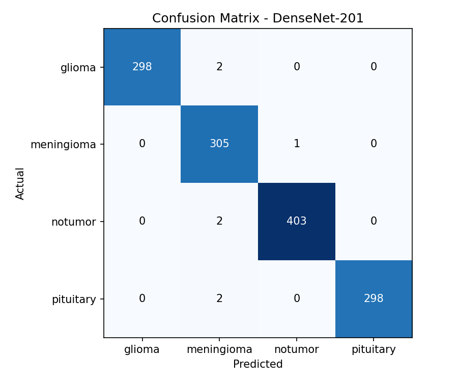
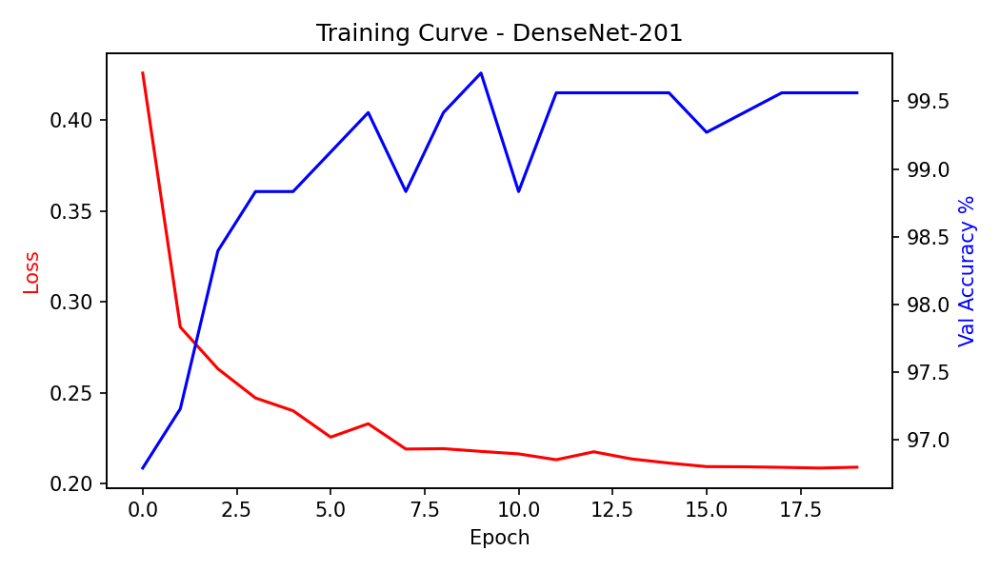
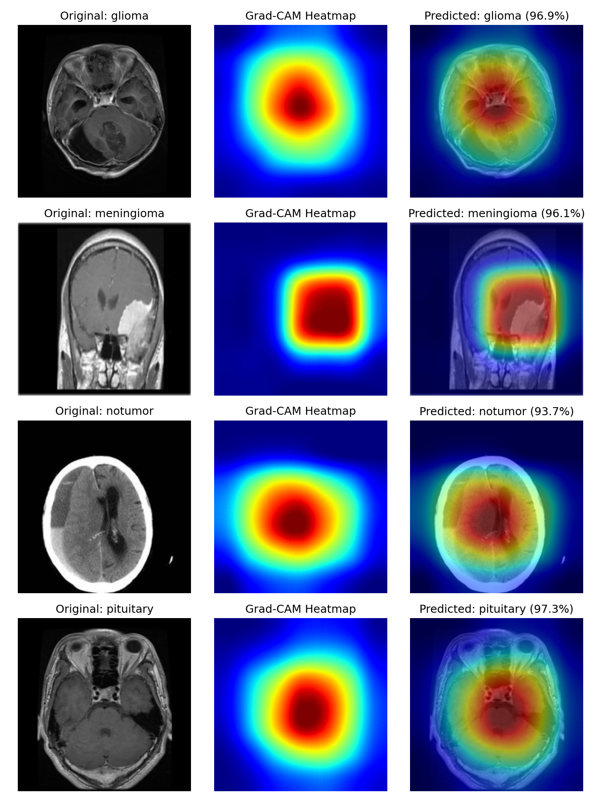

 

 

**The project code, organised as plain Python files — the same code that runs in the Colab notebook.**

---

## ✦ What is this project?

An **explainable AI system** that reads a brain MRI image and classifies it into one of four classes — **Glioma**, **Meningioma**, **Pituitary** or **No Tumor** — and explains every decision with a **Grad-CAM** heatmap showing which region drove it. It is a **decision-support tool** for clinicians, never a replacement for them or for biopsy.

The full project README is one level up: **[../README.md](../README.md)**. This folder holds the code from the notebook ([`../model/BrainTumor.ipynb`](../model/BrainTumor.ipynb)) split into modules.

## 📂 The code

| File | What it does |
|---|---|
| `dataset.py` | Finds the dataset (Training/Testing at any depth), makes the seed-42 stratified train/val split, transforms + augmentation, DataLoaders |
| `model.py` | DenseNet-201 (ImageNet-pretrained) with the 4-class head — dropout 0.3 + linear |
| `train.py` | The full run: 20 epochs, AdamW + cosine schedule, label smoothing 0.05, best checkpoint by validation macro F1, one final test evaluation, all figures + results saved |
| `evaluate.py` | Accuracy, per-class precision/recall/F1 and the confusion matrix; formats `results.txt` |
| `predict.py` | Predict a single MRI image from the trained checkpoint |
| `gradcam.py` | Hook-based Grad-CAM on the last dense block; single-image heatmaps and the 4-class example panel |
| `requirements.txt` | Python libraries needed |
| `HOW_TO_RUN.md` | Step-by-step, error-proof run guide (Colab + Drive) |
| `art.svg` | The README artwork |

## 🌐 Live Website — try it now

The trained model runs as a web app — prediction, class probabilities, Grad-CAM heatmap, focus box and a downloadable PDF report, 100% in the browser:

**▶ Live demo: [fcub-cse-brain-tumor-mri-ai.static.hf.space](https://fcub-cse-brain-tumor-mri-ai.static.hf.space)** · **Short link: [tinyurl.com/BrainTumorMRI](https://tinyurl.com/BrainTumorMRI)** — code in [`../Website/`](../Website/)

## 🏆 Results — official run (Google Colab, Tesla T4)

| Metric | Score |
|---|---|
| **Test Accuracy** | **99.47%** (1304 / 1311) |
| **Macro F1** | **99.46%** |

| Class | Precision | Recall | F1 | Support |
|---|---|---|---|---|
| Glioma | **100.00%** | 99.33% | 99.67% | 300 |
| Meningioma | 98.07% | 99.67% | 98.87% | 306 |
| No Tumor | 99.75% | 99.51% | 99.63% | 405 |
| Pituitary | **100.00%** | 99.33% | 99.67% | 300 |

Only **7 of 1,311** test images were misclassified — six of the seven were read as meningioma.

## 🔬 Explainability — Grad-CAM

For correct predictions the heatmaps sit on the tumour itself — the same place a radiologist would look. A heatmap is a sensitivity map, not clinical proof.

## 👨‍💻 Author

**MD. Shadhin Khan**
 Student ID: 0572310005101003
 Department of Computer Science & Engineering
 First Capital University of Bangladesh, Chuadanga
 **Supervisor:** Md. Rashed Billah, Lecturer, CSE
 **Co-Supervisor:** Nurunnahar Tisha, Lecturer, CSE

---

*Every number here comes from the saved outputs of the official run, and every step can be reproduced from the notebook.*

© 2026 Shadhin Khan • Explainable Brain Tumor Classification Using DenseNet-201 and Grad-CAM

