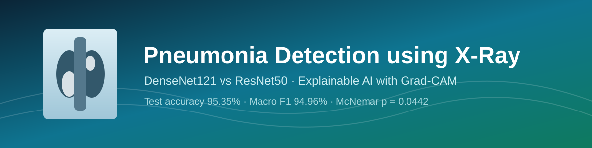
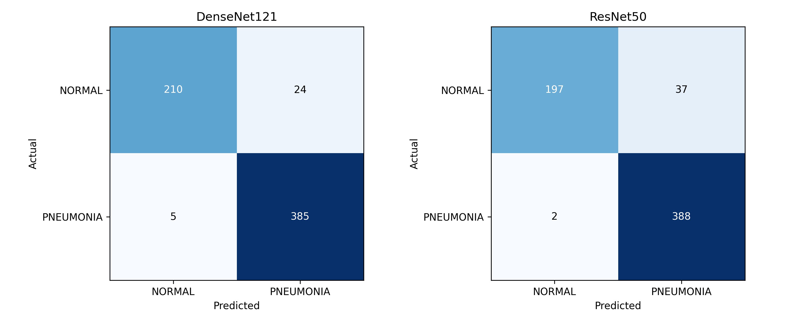
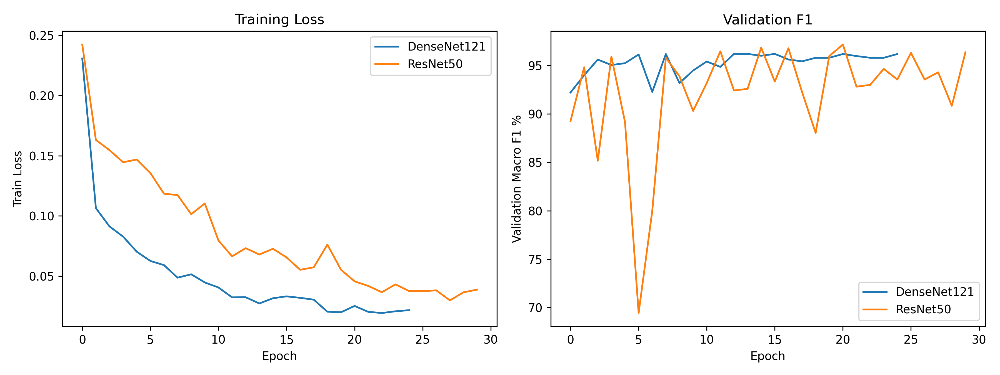
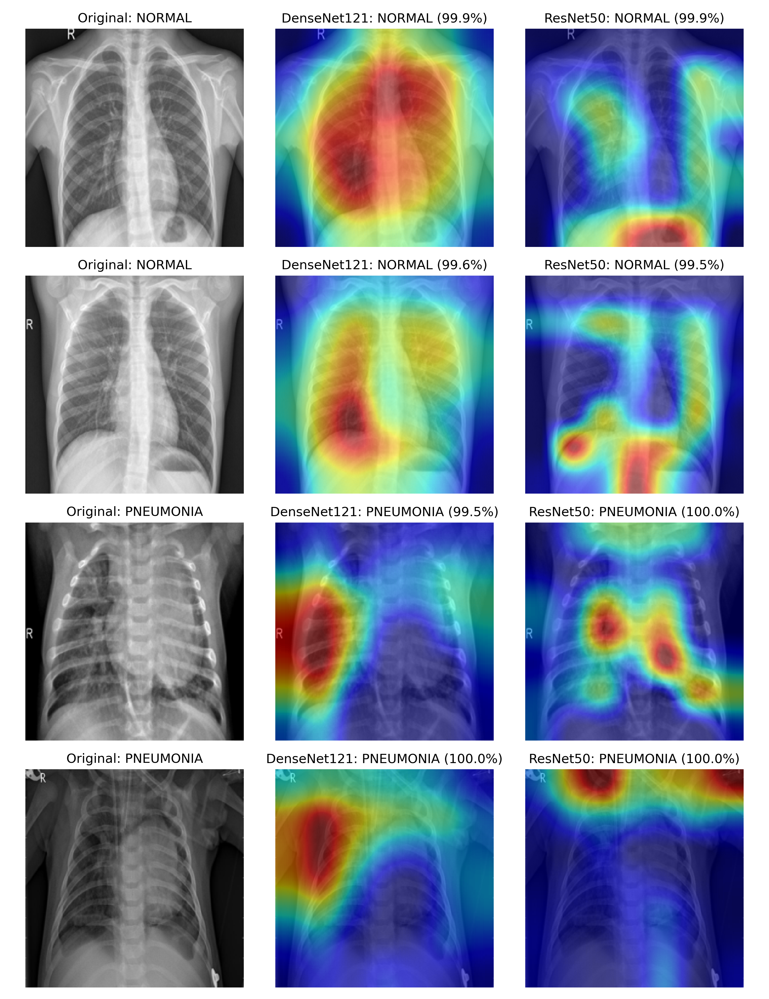

<h1 align="center">🫁 Pneumonia Detection using X-Ray</h1>

<p align="center">
  <b>A Comparative Study of DenseNet121 and ResNet50 for Explainable Pneumonia Detection<br/>from Chest X-Ray Images with Grad-CAM</b>
</p>

<p align="center">
  
  
  
  
</p>

<p align="center">
  
</p>

## ✦ What is this project?

Pneumonia kills quietly — and its earliest evidence sits inside a chest X-ray, in the white opacities that cloud infected lungs. Reading those films well takes a trained radiologist, and radiologists are scarce. This project builds an **explainable AI screening system** that reads a chest X-ray and classifies it into one of two classes:

| Class | Meaning |
| --- | --- |
| 🟢 **Normal** | A healthy chest — the lungs are clear, with no sign of infection |
| 🔴 **Pneumonia** | Opacities consistent with pneumonia — the film needs a clinician's attention |

Two well-known architectures — **DenseNet121** and **ResNet50** — were trained under **one identical protocol** and compared head-to-head, so the comparison is about the architectures, not about who got the better recipe. The system does not just give an answer: with **Grad-CAM** it paints a heatmap over the scan showing **which region drove the decision**, so a doctor can verify the model actually looked inside the lungs. It is a **decision-support tool** — a fast, tireless second reader that supports clinicians, never replaces them.

## 🌐 Live Website — try it now

The winning model (DenseNet121) is deployed as a web app: upload a chest X-ray and get the prediction, a **Grad-CAM overlay** with a focus box marking the region that drove the decision, and a downloadable **PDF report**. Before analysing anything, the site checks that the uploaded image really looks like a chest X-ray — screenshots and ordinary photos are refused.

**▶ Live demo: [fcub-cse-pneumonia-xray-ai.static.hf.space](https://fcub-cse-pneumonia-xray-ai.static.hf.space)** — Hugging Face Spaces (static hosting; the model runs 100% in your browser, no server to wake up)

**▶ Short link: [is.gd/PneumoniaXrayAI](https://is.gd/PneumoniaXrayAI)** — the same live site, short enough to type or say out loud

All the website code and details live in the **[Website/](Website/)** folder:

- `Website/static-app/` — the version running live on Hugging Face (in-browser ONNX model)

## 🏆 Results — official run (Google Colab, Tesla T4)

| Metric | DenseNet121 | ResNet50 |
| --- | --- | --- |
| **Test Accuracy** | **95.35%** (595 / 624) | 93.75% (585 / 624) |
| **Macro F1** | **94.96%** | 93.10% |
| ROC-AUC | 0.9882 | 0.9878 |
| PR-AUC | 0.9900 | **0.9915** |
| Sensitivity | 98.72% | **99.49%** |
| Specificity | **89.74%** | 84.19% |
| Errors | **29** (24 FP + 5 FN) | 39 (37 FP + 2 FN) |
| Parameters | **6,955,906** | 23,512,130 |

**DenseNet121 — per-class detail**

| Class | Precision | Recall | F1 | Support |
| --- | --- | --- | --- | --- |
| Normal | 97.67% | 89.74% | 93.54% | 234 |
| Pneumonia | 94.13% | 98.72% | 96.37% | 390 |

**ResNet50 — per-class detail**

| Class | Precision | Recall | F1 | Support |
| --- | --- | --- | --- | --- |
| Normal | 98.99% | 84.19% | 90.99% | 234 |
| Pneumonia | 91.29% | 99.49% | 95.21% | 390 |

The smaller model wins — and the win is real, not noise: a **McNemar test** on the paired predictions gives χ² = 4.05, **p = 0.0442** (< 0.05). The two models disagree on only 20 films (DenseNet right on 15 of them, ResNet on 5), and both miss almost no pneumonia (5 and 2 false negatives) — the gap is in false alarms, where DenseNet121 raises 24 against ResNet50's 37. The full record is in [`results/results.txt`](results/results.txt).

 

## 🔬 Explainability — Grad-CAM



For the checked films, DenseNet121's heatmaps stay **inside the lung fields**, on the opacities a radiologist would read. ResNet50 is mostly right too — but on some films its attention drifts **below the diaphragm and toward the shoulders**: right answers, partly wrong reasons. That difference never shows up in an accuracy table, and it is exactly why the explanation is part of the comparison. A heatmap is a sensitivity map, not clinical proof — the paper states this limitation openly.

## 🧠 How it works

```
Chest X-ray image (Kermany dataset)
      │
      ▼
Preprocessing — resize · normalise · (training only: augmentation)
      │
      ▼
DenseNet121  ·  ResNet50 — ImageNet-pretrained, fine-tuned end to end
      │
      ▼
Normal / Pneumonia prediction + probabilities
      │
      ▼
Grad-CAM heatmap — the explanation
```

**Key design choices**

- **One protocol for both models** — the official train and validation folders are pooled (5,232 films) and re-split once, seed 42, stratified 88/12 → **4,604 train + 628 validation**. The official **624-image test set is evaluated exactly once**, at the very end. No test tuning, ever.
- **Each model gets its published recipe** — DenseNet121: SGD (lr 0.001, momentum 0.9, weight decay 1e-4), cosine schedule, 25 epochs, batch 32. ResNet50: Adam (lr 0.001), step schedule (halved every 10 epochs), 30 epochs, batch 16. Nobody loses because of a bad recipe.
- **Class weighting** — the pool is imbalanced (1,349 Normal vs 3,883 Pneumonia), so the loss weights the classes ≈ 1.94 / 0.67, and the checkpoint is chosen by **validation macro F1**, not raw accuracy.
- **Transfer learning** — only the classifier head is new (2 classes); the ImageNet-pretrained backbones already understand edges, textures and shapes, and the whole networks are fine-tuned.
- **Analytic Grad-CAM** — with global average pooling feeding the classifier, the class activation map is computed exactly from the final convolutional features (DenseNet121: 1,024 × 7 × 7; ResNet50: 2,048 × 7 × 7) — the same computation that powers the live website's overlay.
- **Honest evaluation** — the split is regenerated from seed 42, so re-running the notebook reproduces the exact same train/validation split; small run-to-run variation is normal for GPU training.

## 📦 The dataset — Chest X-Ray Images (Pneumonia), Kermany et al.

**5,856 real chest X-ray images** in two classes (Kermany et al., 2018 — paediatric patients, Guangzhou Women and Children's Medical Center), distributed on Kaggle:

| Official split | Normal | Pneumonia | Total |
| --- | --- | --- | --- |
| Train | 1,341 | 3,875 | 5,216 |
| Validation | 8 | 8 | 16 |
| Test | 234 | 390 | 624 |

> ⚠️ **Counting note:** Kaggle's page often quotes 5,863 images, but the folders themselves contain **5,856** files — every number in this project comes from counting the actual files. The official validation split (16 films) is too small to select checkpoints with, which is why train + validation are pooled and re-split as described above.

📥 **Get it:** [Chest X-Ray Images (Pneumonia) on Kaggle](https://www.kaggle.com/datasets/paultimothymooney/chest-xray-pneumonia) · details in [`dataset/DATASET.md`](dataset/DATASET.md). The dataset itself is **not** included in this repository.

## 🛠 Tech stack

| Choice | Why this one |
| --- | --- |
| **Python + PyTorch** | The research standard; full control over the training loop and checkpoint rule |
| **DenseNet121 + ResNet50** | Two opposite design philosophies — dense connections vs residual connections — and the two strongest single-model families in this dataset's literature |
| **Google Colab · Tesla T4** | Free GPU — both models train in about two hours instead of days on CPU |
| **Grad-CAM** | Fast, CNN-native explanations (LIME/SHAP are far slower on images) |
| **ONNX Runtime Web** | The same trained DenseNet121 runs inside the visitor's browser on the live website — verified to reproduce the PyTorch result exactly (95.35%, identical confusion matrix) |

## 📂 What's inside

```
Pneumonia Detection using X-Ray/
├── assets/              ← the run guide, requirements & README artwork
│   ├── HOW_TO_RUN.md    ← step-by-step, error-proof run guide
│   ├── requirements.txt
│   └── art.svg
├── model/               ← the training notebook
│   └── Pneumonia.ipynb  ← the full pipeline — run this in Colab
├── paper/               ← the full project paper (PDF)
├── slide/               ← the presentation (PPTX)
├── results/             ← metrics + figures from the official run
├── dataset/             ← about the Kermany chest X-ray dataset
└── Website/             ← the live web app
```

The trained winning checkpoint (`best_DenseNet121.pth`, 28.4 MB) is attached to the [**pneumonia-v1.0 release**](https://github.com/Sadhin404/Ai-ML-Deep-Learning-Project/releases/tag/pneumonia-v1.0) — it is too large to keep in the git tree. The ResNet50 comparison checkpoint is not distributed; retrain it from the notebook under the same protocol.

## ⚠️ Limitations — stated honestly

- **One dataset, one centre, paediatric films** — the patients are children aged 1–5 from a single medical centre. Performance on adult films or other hospitals' data is **not** claimed; external validation is future work.
- The split is image-level (the dataset provides no patient IDs), so patient-independent generalisation is **not** claimed.
- Both models lean toward false alarms over misses (24–37 FP vs 2–5 FN) — safer for screening, but every positive still needs a clinician.
- Grad-CAM shows where the model is sensitive — it is an aid to verification, not medical evidence.
- Scores of 98%+ sometimes quoted for this dataset come from re-split or cross-validated protocols and are **not comparable** with an official-test result like this one.

## 👨‍💻 Author


**MD. Shadhin Khan**
Student ID: 0572310005101003
Department of Computer Science & Engineering
First Capital University of Bangladesh, Chuadanga

**Supervisor:** Md. Rashed Billah, Lecturer, CSE
**Co-Supervisor:** Nurunnahar Tisha, Lecturer, CSE

[](https://www.facebook.com/share/1GRMfN9pwh/) [](https://www.instagram.com/sadhin.404) [](https://github.com/Sadhin404)

---

*Built to be understood — every number in this README comes from the saved outputs of the official run, and every step can be reproduced from the notebook.*

© 2026 Shadhin Khan • A Comparative Study of DenseNet121 and ResNet50 for Explainable Pneumonia Detection from Chest X-Ray Images with Grad-CAM


