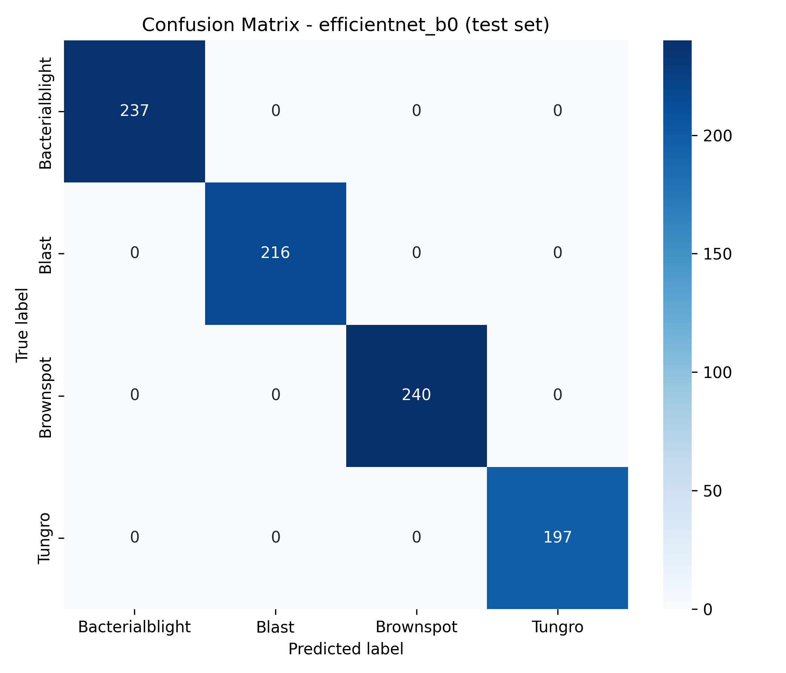
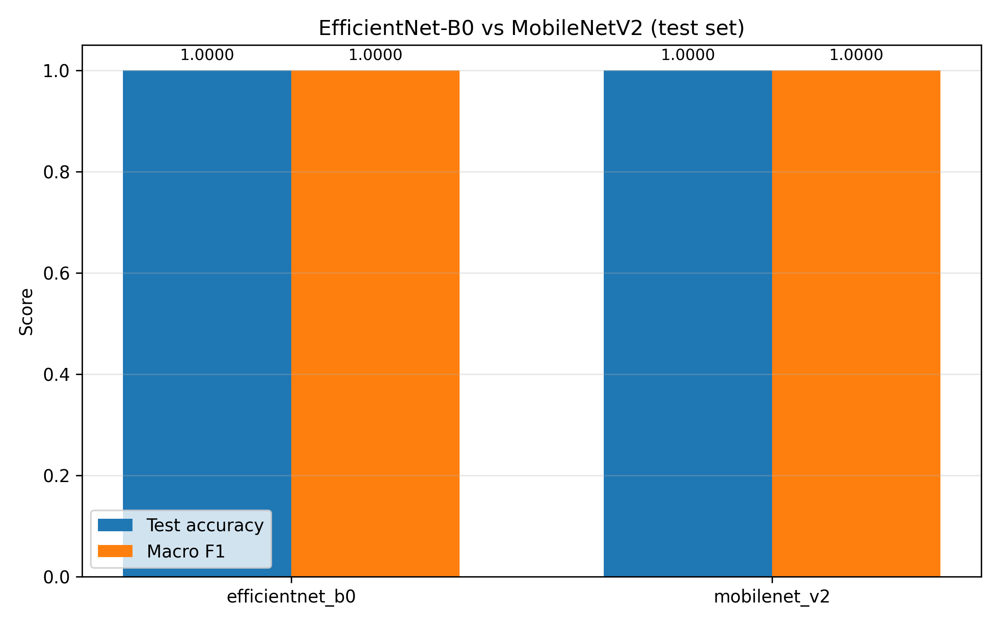
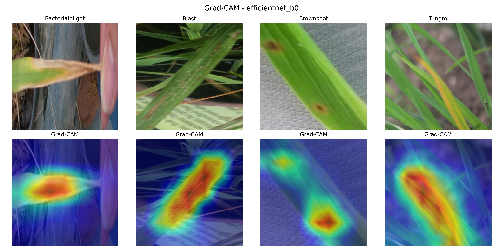

<h1 align="center">🌾 Rice Leaf Disease Classification</h1>

<p align="center">
  <b>A Comparative Study of EfficientNet-B0 and MobileNetV2 for Explainable<br/>Rice Leaf Disease Classification with Grad-CAM</b>
</p>

<p align="center">
  
  
  
  
</p>

<p align="center">
  <a href="model/Rice_Leaf_Disease_EfficientNetB0_vs_MobileNetV2_T4.ipynb"></a>
  <a href="https://www.kaggle.com/datasets/nirmalsankalana/rice-leaf-disease-image"></a>
  <a href="paper/Rice_Leaf_Disease_Paper.pdf"></a>
  <a href="https://fcub-cse-rice-leaf-disease.static.hf.space"></a>
  <a href="https://github.com/Sadhin404/Ai-ML-Deep-Learning-Project/releases/tag/rice-leaf-v1.0"></a>
</p>

<p align="center">
  <i>A deep-learning project — an AI field assistant for the rice field, with an explanation for every decision.</i>
</p>

<p align="center">
  
</p>

## ✦ What is this project?

Rice feeds Bangladesh — and half the world. But four major leaf diseases quietly cut the yield of every season, and telling them apart in the field takes an expert eye that most farmers do not have at hand. This project builds an **explainable AI system** that reads a photo of a rice leaf and classifies it into one of four diseases:

| Class | Cause | What it looks like |
| --- | --- | --- |
| 🦠 **Bacterial Blight** | Bacterium (*Xanthomonas oryzae*) | Water-soaked stripes spreading from the leaf tip and margins, turning yellow-white |
| 🍄 **Blast** | Fungus (*Magnaporthe oryzae*) | Spindle-shaped "eye" spots — grey-white centre, brown border |
| 🟤 **Brown Spot** | Fungus (*Bipolaris oryzae*) | Round dark-brown spots scattered like sesame seeds — often a sign of poor soil nutrition |
| 🪰 **Tungro** | Virus (spread by the green leafhopper) | Yellow-orange discoloration from the leaf tips, stunted plants |

The cause decides the treatment — a bactericide does nothing against a fungus, and tungro has no direct cure at all — so naming the **right** disease matters, not just spotting "a disease". Two lightweight architectures — **EfficientNet-B0** and **MobileNetV2** — were trained under **one identical protocol** and compared head-to-head. And the system does not just give an answer: with **Grad-CAM** it shows **which part of the leaf drove the decision**, so the user can verify the model looked at the diseased tissue, not the background.

## 🌐 Live Website — try it now

Both models are deployed as a web app: upload a leaf photo, pick a model, and get the **disease name**, the **Grad-CAM heatmap**, and **three practical next steps** for that disease. Deliberately, the site shows **no accuracy or confidence numbers** — a farmer should see a name, the evidence, and what to do next, not a percentage that could be misread as a promise.

**▶ Live demo: [fcub-cse-rice-leaf-disease.static.hf.space](https://fcub-cse-rice-leaf-disease.static.hf.space)** — Hugging Face Spaces (static hosting; both models run 100% in your browser, no server to wake up)

**▶ Short link: [is.gd/RiceLeafDisease](https://is.gd/RiceLeafDisease)** — the same live site, short enough to type or say out loud

All the website code and details live in the **[Website/](Website/)** folder:

- `Website/static-app/` — the version running live on Hugging Face (in-browser ONNX models)

## 🏆 Results — official run (Google Colab, Tesla T4)

| Metric | EfficientNet-B0 | MobileNetV2 |
| --- | --- | --- |
| **Test Accuracy** | **100%** (890 / 890) | **100%** (890 / 890) |
| **Macro F1** | **1.000** | **1.000** |
| ROC-AUC (per class) | 1.000 | 1.000 |
| Errors | **0** | **0** |
| Validation accuracy reached 100% | epoch 2 | epoch 3 |
| Parameters | 4,012,672 | **2,228,996** (44% fewer) |
| Checkpoint size | 16.4 MB | **9.2 MB** |

**Per-class detail — identical for both models**

| Class | Precision | Recall | F1 | Support |
| --- | --- | --- | --- | --- |
| Bacterial Blight | 1.000 | 1.000 | 1.000 | 237 |
| Blast | 1.000 | 1.000 | 1.000 | 216 |
| Brown Spot | 1.000 | 1.000 | 1.000 | 240 |
| Tungro | 1.000 | 1.000 | 1.000 | 197 |

Both confusion matrices are perfectly diagonal — not one leaf was confused with another disease. The full record is in the [`results/`](results/) folder (`results.json`, `results_summary.csv` and the per-model classification reports).

**How to read a perfect score — honestly.** A 100% result deserves suspicion, so here is exactly what it does and does not mean. The test set was fully held out (never used in training, checkpoint selection or tuning) and the two architectures reached the score **independently**; Grad-CAM (below) confirms both decide from the diseased tissue. Statistically, 0 errors in 890 trials means the true accuracy is **at least 99.66%** (rule of three, 95% confidence) — not "always perfect". And this dataset is clean and comparatively easy: real field photos, with mixed light, cluttered backgrounds and several problems on one leaf, will score lower. That field validation is future work, stated openly in the paper. Because neither model made a single error, a McNemar comparison is not applicable (there are no disagreements to test) — so the verdict is decided by **cost**: the same perfect score from MobileNetV2 at 44% fewer parameters makes it the recommended default, especially for phones.

 

## 🔬 Explainability — Grad-CAM



Eight cases were checked (four classes × two models): in **every** case the heatmap sits on the **diseased tissue** — never the background, never a healthy part of the leaf. EfficientNet-B0's focus is a little tighter; MobileNetV2's is a little broader; the centre is the same. This is the strongest support for the perfect score: the models are right **for the right reason**. A heatmap is a sensitivity map, not proof — the paper states this limitation openly.

## 🧠 How it works

```
Rice leaf photo (Kaggle dataset)
      │
      ▼
Preprocessing — resize · centre crop · normalise · (training only: augmentation)
      │
      ▼
EfficientNet-B0  ·  MobileNetV2 — ImageNet-pretrained, fine-tuned end to end
      │
      ▼
4-class prediction
      │
      ▼
Grad-CAM heatmap — the explanation
```

**Key design choices**

- **One protocol for both models** — the dataset is split once, seed 42, stratified **70/15/15** → **4,152 train + 890 validation + 890 test**. The test set is evaluated **exactly once**, at the very end.
- **Identical recipe** — AdamW (lr 1e-4, weight decay 1e-4), cross-entropy with **label smoothing 0.1**, batch 32, 12 epochs, cosine schedule. Checkpoint = best validation accuracy. (Label smoothing is also why the training loss settles near 0.36 instead of 0 — with a 0.9 target, that is the mathematical floor, not a failure.)
- **Transfer learning** — only the classifier head is new (`classifier[1]` → 4 classes); both backbones end in a 1,280-dimensional feature, and the whole networks are fine-tuned.
- **Lightweight by design** — the destination is a farmer's phone, so both contenders are mobile-class architectures: EfficientNet-B0 (compound scaling, MBConv blocks with squeeze-and-excitation attention) against MobileNetV2 (depthwise separable convolutions, inverted residuals with linear bottlenecks).
- **Analytic Grad-CAM** — with global average pooling feeding the classifier, the class activation map is computed exactly from the final 1,280 × 7 × 7 features — the same computation that powers the live website's heatmap.
- **Honest evaluation** — the split is regenerated from seed 42, so re-running the notebook reproduces the exact same split.

## 📦 The dataset — Rice Leaf Disease Image (Kaggle)

**5,932 leaf images** in four classes, roughly 300 × 300 pixels each:

| Class | Images | Share of test set |
| --- | --- | --- |
| Bacterial Blight | 1,584 | 237 |
| Blast | 1,440 | 216 |
| Brown Spot | 1,600 | 240 |
| Tungro | 1,308 | 197 |

The classes are close to balanced (largest : smallest ≈ 1.22 : 1), so no class weighting was needed. The images are comparatively clean — the leaf fills the frame and the backgrounds are simple — which is part of why the scores above are as high as they are.

📥 **Get it:** [Rice Leaf Disease Image on Kaggle](https://www.kaggle.com/datasets/nirmalsankalana/rice-leaf-disease-image) · details in [`dataset/DATASET.md`](dataset/DATASET.md). The dataset itself is **not** included in this repository. (The notebook loads the identical dataset from its Hugging Face mirror, `Project-AgML/rice_leaf_disease_classification_india`, so it runs in Colab without a Kaggle download.)

## 🛠 Tech stack

| Choice | Why this one |
| --- | --- |
| **Python + PyTorch** | The research standard; full control over the training loop and checkpoint rule |
| **EfficientNet-B0 + MobileNetV2** | The two rival philosophies of lightweight design — accuracy-first vs efficiency-first |
| **Google Colab · Tesla T4** | Free GPU — both models train quickly instead of hours on CPU |
| **Grad-CAM** | Fast, CNN-native explanations (LIME/SHAP are far slower on images) |
| **ONNX Runtime Web** | Both trained models run inside the visitor's browser on the live website — verified against PyTorch on real images before deployment |

## 📂 What's inside

```
Rice Leaf Disease Classification/
├── assets/              ← the run guide, requirements & README artwork
│   ├── HOW_TO_RUN.md    ← step-by-step, error-proof run guide
│   ├── requirements.txt
│   └── art.svg
├── model/               ← the training notebook
│   └── Rice_Leaf_Disease_EfficientNetB0_vs_MobileNetV2_T4.ipynb
├── paper/               ← the full project paper (PDF)
├── slide/               ← the presentation (PPTX)
├── results/             ← metrics + figures from the official run
├── dataset/             ← about the rice leaf disease dataset
└── Website/             ← the live web app
```

Both trained checkpoints (`best_efficientnet_b0.pth`, 16.4 MB · `best_mobilenet_v2.pth`, 9.2 MB) are attached to the [**rice-leaf-v1.0 release**](https://github.com/Sadhin404/Ai-ML-Deep-Learning-Project/releases/tag/rice-leaf-v1.0) — they are kept out of the git tree.

## ⚠️ Limitations — stated honestly

- **One dataset, comparatively clean images** — the photos are orderly, with simple backgrounds. Performance on real field photos (mixed light, hands, soil, several problems on one leaf) is **not** established; field validation is the first future work.
- With 890 test images and zero errors, the honest statistical claim is **true accuracy ≥ 99.66%** (95% confidence) — this README's 100% badge reports the measured test score, nothing more.
- Both models reached the ceiling of this benchmark, so their fine differences **cannot** be measured on this dataset — a harder dataset is needed to separate them.
- The split is image-level, and disease **severity** is not estimated — the system names the disease, not how bad it is.
- Grad-CAM shows where the model is sensitive — it is an aid to verification, not agronomic evidence. Field decisions should still involve an agricultural expert.

## 👨‍💻 Author


**MD. Shadhin Khan**
Student ID: 0572310005101003
Department of Computer Science & Engineering
First Capital University of Bangladesh, Chuadanga

**Supervisor:** Md. Rashed Billah, Lecturer, CSE
**Co-Supervisor:** Nurunnahar Tisha, Lecturer, CSE

[](https://www.facebook.com/share/1GRMfN9pwh/) [](https://www.instagram.com/sadhin.404) [](https://github.com/Sadhin404)

---

*Built to be understood — every number in this README comes from the saved outputs of the official run, and every step can be reproduced from the notebook.*

© 2026 Shadhin Khan • A Comparative Study of EfficientNet-B0 and MobileNetV2 for Explainable Rice Leaf Disease Classification with Grad-CAM


