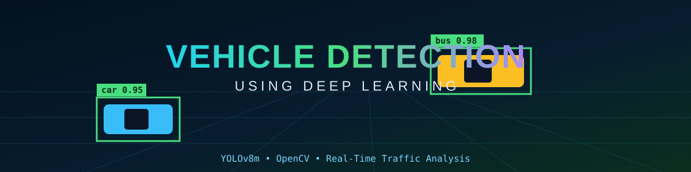
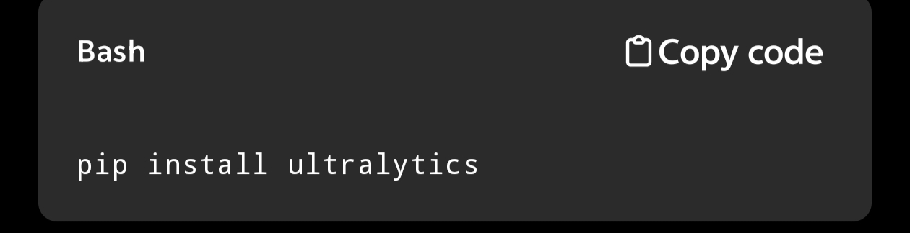

<div align="center">



<br/>


**Real-time vehicle detection and classification from traffic video — one look, every vehicle boxed, labelled and scored.**

[📄 Read the Paper](paper/) · [🎞️ View the Presentation](presentation/) · [🐍 Get the Code](model/) · [🖼️ Assets](assets/)

</div>

---

## 🚦 About the Project

Roads carry more vehicles every year, but counting and classifying them is still mostly done by human eyes — slow, costly and error-prone. This project solves that with deep learning: a **YOLOv8m** model watches a traffic video frame by frame and detects every **car, bus, truck and motorbike** in real time, drawing a labelled bounding box with a confidence score around each one.

The complete system is a single, readable Python program (~55 lines) built on **Ultralytics YOLOv8** and **OpenCV** — no complex pipeline, just a clean loop: *read frame → detect → filter the four vehicle classes → draw → display*.

| | |
|---|---|
| **Course** | CSE-326, Third Year Second Semester |
| **University** | First Capital University of Bangladesh, Chuadanga |
| **Supervisor** | Saifa Azmiri Mohona, Lecturer, CSE |
| **Author** | MD. Shadhin Khan — ID: 0572310005101003, Batch 27 |
| **Team** | Ali Emam Rabbi (0572320005101025, Batch 28) · Sristi Khatun (0572310005101050, Batch 28) |

---

## 📊 Results — Measured, Not Promised

Tested on real traffic video (`traffic.mp4`, 720p @ 30 FPS) on a Ryzen 5 Pro 7540U laptop with 32 GB RAM:

| Vehicle Class | Accuracy |
|---|:---:|
| 🚌 Bus | **98%** |
| 🚚 Truck | **98%** |
| 🚗 Car | **95%** |
| 🏍️ Motorbike | **85%** |
| **Average** | **94%** |

Motorbike is the hardest class — the smallest and fastest vehicle, often partly hidden behind larger ones. Buses and trucks, large and distinctive, are detected almost perfectly.

---

## 🖼️ Screenshots

<div align="center">

<br/><br/>

</div>

---

## ⚙️ How It Works

```
 traffic.mp4 ──► OpenCV reads frame ──► YOLOv8m inference ──► keep car / bus / truck / motorbike
                                                                      │
              live window "YOLO Vehicle Detection" ◄── draw box + label + confidence ◄──┘
                         (press Q to quit)
```

1. **Load** — the pre-trained `yolov8m.pt` model (COCO) is loaded with Ultralytics.
2. **Read** — OpenCV streams the traffic video frame by frame (up to 5,400 frames).
3. **Detect** — YOLOv8 predicts boxes, classes and confidence in a single pass.
4. **Filter** — only the four vehicle classes are kept; everything else is ignored.
5. **Draw & show** — green boxes with `class + confidence` labels, shown live.

---

## ▶️ How to Run

**1. Install the two libraries**

```bash
pip install ultralytics opencv-python
```

**2. Get the files** — you need, side by side in one folder:

- [`model/vehicle_detection.py`](model/vehicle_detection.py) — the main code
- `yolov8m.pt` — the model weights (Ultralytics also downloads it automatically on first run)
- `traffic.mp4` — the test video

> 📦 The smaller weights (`yolov8n.pt`, `yolov8s.pt`) are **already in the `model/` folder**. The test video (234 MB) and `yolov8m.pt` (52 MB) are too large for a GitHub repo, so they are kept in the project's Google Drive folder — full details and the download link are in **[model/DOWNLOAD_FILES.md](model/DOWNLOAD_FILES.md)**:
> **https://drive.google.com/drive/folders/1Kg839s5E8DNiQAOGJVrLK2Njd572vIlA**

**3. Run**

```bash
python vehicle_detection.py
```

A window titled **"YOLO Vehicle Detection"** opens and detection starts immediately. Press **Q** to stop.

---

## 📁 Repository Structure

```
Traffic Detection/
├── README.md                  ← you are here
├── model/
│   ├── vehicle_detection.py   ← the complete detection program
│   ├── yolov8n.pt             ← YOLOv8 nano weights
│   ├── yolov8s.pt             ← YOLOv8 small weights
│   └── DOWNLOAD_FILES.md      ← Drive link for the test video + yolov8m weight
├── assets/
│   ├── banner.svg             ← animated header
│   ├── IMG_20251107_212810.jpg
│   └── IMG_20251107_212938.jpg
├── paper/
│   └── Sadhin - Vehicle Detection Using Deep Learning.pdf
└── presentation/
    └── Vehicle_Detection_3D_Presentation_ULTIMATE.pptx
```

---

## 📄 Paper & Presentation

- **Project paper** — the full 40-page report (system design, implementation, results and analysis) is in the [`paper/`](paper/) folder.
- **Presentation** — the animated 3D slide deck used for the project defence is in the [`presentation/`](presentation/) folder. Open it in Microsoft PowerPoint and press **F5** — transitions and animations play in slideshow mode.

---

## 🔮 Future Work

- Fine-tune YOLOv8 on Bangladeshi traffic data
- Vehicle counting and tracking (ByteTrack) with counting lines
- Live CCTV / webcam input with a traffic dashboard
- Speed estimation and violation alerts

---

<div align="center">

**MD. Shadhin Khan** · Department of Computer Science & Engineering
First Capital University of Bangladesh, Chuadanga

</div>
